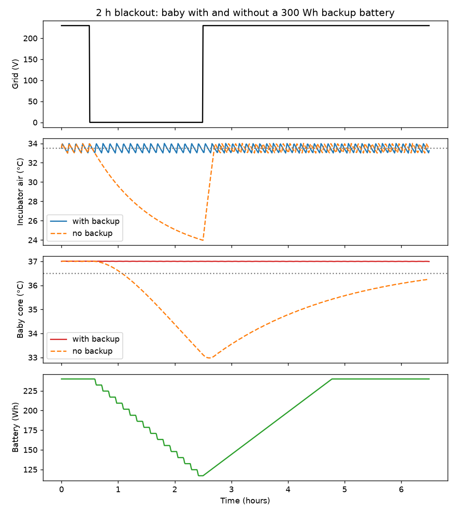

# Resilient Infant Incubator: Power Failure Simulation

Python simulation of an infant incubator and a preterm baby during mains outages and sustained undervoltage, with a backup battery and a controller.

**Try it online:** [live dashboard](https://incubator-power-resilience.streamlit.app) | **More projects:** [portfolio](https://alusine-bah.github.io)

## Summary
When the grid fails, how long does a baby in an incubator stay warm, and how big must a backup battery be? This project simulates an incubator, a 2 kg preterm baby and a backup battery through blackouts and long low-voltage events. It checks its own results against earlier runs and lists what it leaves out.

Main results from this model (inputs marked as assumptions are listed in PARAMETERS.md):
- With no backup, a 2 h blackout lowers the modelled baby's core temperature to about 31 to 34 °C.
- With a battery that takes over at once, the baby stays near 37 °C. The battery uses about 64 Wh per outage hour, so a rating of about 154 Wh for 2 h and 240 Wh for 3 h at 80 percent usable.
- A 300 W heater rides through grid voltage down to 0.55 of nominal without a battery in the cases tested. A 200 W heater does not when heat loss is high (UA 8).
- The heat-loss value is not validated against a real incubator, and battery size scales directly with it.

**Educational model. Not a medical device and not for clinical decisions.**

## Status
Early stage. Several parameters are assumptions (see PARAMETERS.md for the source and status of each). Not validated against a real device. No measured steady-state power figure for a neonatal incubator has been found yet.

## Files
- model.py: the simulation and all parameters
- app.py: interactive dashboard
- check_model.py and reproduce_findings.py: re-run earlier results through model.py and compare them with this README
- make_figure.py: regenerates the example figure in docs/
- PARAMETERS.md: where each input comes from, and the papers reviewed

## How to run
- Install the packages: python -m pip install -r requirements.txt
- Check the model reproduces earlier results: python check_model.py
- Check every README claim against the model: python reproduce_findings.py
- Start the interactive dashboard: python -m streamlit run app.py
- Regenerate the example figure: python make_figure.py

## Model (current settings)
- Heater 300 W. A 200 W heater fails the 20 min warm-up spec of a commercial unit (VNG 3000 datasheet); 300 W gives 16 min in the model. Heater is a fixed resistance, so power is proportional to voltage squared.
- Heat loss UA = 5 W/°C baseline, tested from 3 to 8. Calculated values in two papers support this range (about 3.8 W/°C, Kapen et al. 2019; about 4.2 W/°C from wall areas, Nwaneri et al. 2020), but neither is measured. Room 22 °C baseline; datasheets list 20 to 30 °C.
- Air setpoint 33.5 °C (neutral temperature for a 2 kg baby in the first days; hospital guideline, handbook chart gives 31 to 34 °C). Thermostat swing +/-0.5 °C.
- Incubator thermal capacity 20 kJ/°C (assumption; 5 to 30 tested, no effect on battery sizing).
- Baby 2 kg, starts at 37.0 °C core. Metabolic heat 2 to 4 W, with heat loss coefficient set so the baby balances at 37.0 °C in 33.5 °C air.
- Battery: converter efficiency 90 percent, 80 percent of rated capacity usable, 60 W charger (assumption).

## Controller
- Mains failure: switch to battery immediately. A real device can detect this directly (the VNG 3000 datasheet lists a power-failure alarm within 30 s).
- Partial undervoltage: use the battery when the air falls 0.6 °C below setpoint, hand back at 0.1 °C below setpoint. The trigger must sit below the thermostat swing; with a 0.8 °C trigger the core settles near 36.46 °C in long events.
- Sensor accuracy (thermistor about 0.5 °C) is comparable to these margins.

## Findings so far
- Sustained undervoltage (6 h at 0.55 to 0.85 of nominal, the range seen in Sierra Leone sensor data): a 300 W heater needs no battery at UA 5 or 8 (lowest core 36.84 °C). A 200 W heater needs no battery at UA 5 but 180 to 275 Wh at UA 8 when the grid is at 0.6 to 0.55.
- Blackout energy at UA 5, room 22 °C, immediate transfer to the battery: about 64 Wh of battery energy per outage hour (63.4 to 63.9 for events of 3 h or more; 61.5 for events of 1.5 to 2 h, because it depends on where the thermostat is in its cycle when the outage starts). This equals UA x (setpoint - room) / efficiency = 5 x 11.5 / 0.9 = 63.9 W, so a rating of about 80 Wh per outage hour at 80 percent usable. It scales with UA by the same formula (UA 8 is 1.6 times higher). Simulated ratings at 80 percent usable: 2 h about 154 Wh, 3 h about 240 Wh, 8 h about 634 Wh, 11 h about 874 Wh. The baby stays at 36.99 °C throughout because the battery takes over at once.
- With no battery, a 2 h blackout lowers the modelled core temperature to about 31 to 34 °C depending on assumed thermal capacity (WHO moderate hypothermia is 32.0 to 35.9 °C axillary; our model gives core temperature, so the comparison is approximate).
- Repeated outages (3 per day for 48 h, battery recharged between them): 1.5 h outages: 150 Wh is the smallest tested rating that never empties (each uses about 92 to 100 Wh, depending on thermostat timing); 3 h outages: 300 Wh is the smallest tested rating that never empties (each outage uses about 192 Wh, so at least 240 Wh is needed). A battery slightly too small gives a steep fall: at 3 h outages, 200 Wh gives a core of 36.40 °C, 150 Wh gives 35.10 °C and 100 Wh gives 33.33 °C.
- Outage evidence: Sierra Leone (15 facilities, 6 weeks) shows 0.6 to 3.1 outages per day and 0.03 to 18 h per day without power; North Kivu (25 facilities, 29 months) shows median outage durations averaging 2.0 h (0.03 to 10.9 h). A 1.5 to 3 h outage is typical, not worst case.

## Limitations
- No radiant heat exchange with cooling walls (likely makes the baby cool too slowly) and constant metabolic heat (likely makes the baby cool too fast). The net effect is unknown. The baby is a single lumped term with no evaporative loss.
- UA is not validated. A measurement method exists (heating power against ambient temperature across several conditions, Feles et al.) but has not been applied to a neonatal incubator.
- Fan and electronics load is not included, and may fail at low voltage. Battery ageing, battery heat and clustered outages are not modelled. Lead-acid batteries may last as little as two years in the field.
- Milliseconds-to-seconds sags and surges, and the equipment damage they cause (a main complaint in Indian special care units, Messersmith et al.), are not modelled.
- Facilities without money for grid power or fuel can be without power for weeks (Waterloo CHC, Sierra Leone). A battery cannot address that.
- Outage patterns are chosen from published ranges, not from a single dataset.

## Next steps
- Test clustered outages with short gaps and a limited charger.
- Replace the assumed fan and electronics load and charger rating with sourced values.
- Find a measured steady-state power figure for a neonatal incubator.

## Author
Alusine Bah

## License
MIT. See the LICENSE file.
