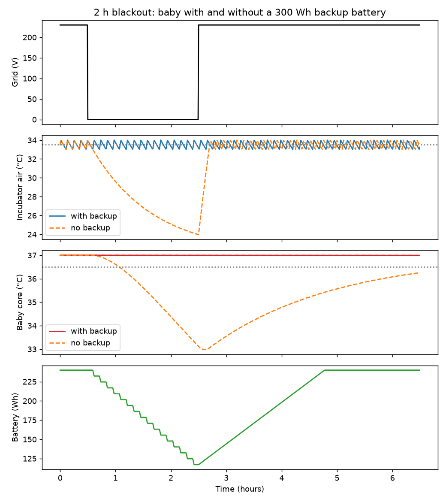
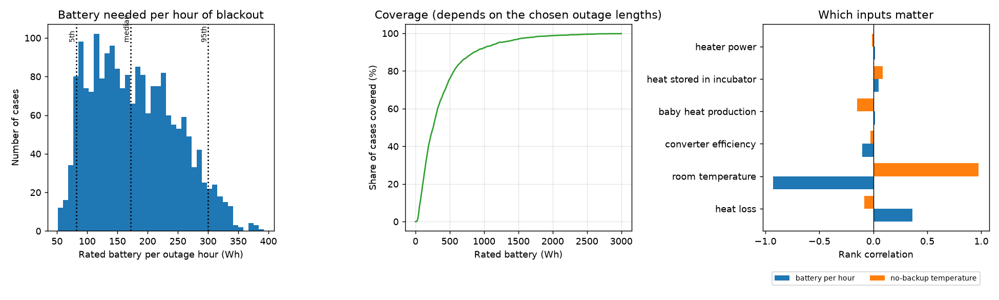
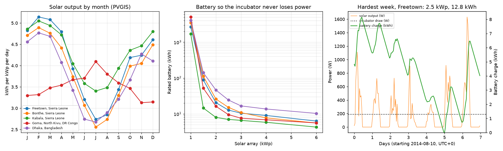

# Resilient Infant Incubator: Power Failure Simulation

**Try it online:** [live dashboard](https://incubator-power-resilience.streamlit.app) | **More projects:** [portfolio](https://alusine-bah.github.io)

## Summary
When the grid fails, how long does a baby in an incubator stay warm, and how big must a backup battery be? This project simulates an incubator, a preterm baby (0.5 to 4 kg) and a backup battery through blackouts and long low-voltage events. It uses a heat loss measured on one commercial incubator and outage data from published sensor studies, and a script re-runs every number in this README against the model.

Main results for the default incubator, a 2 kg baby and a 22 °C room. Inputs that are assumptions are listed in PARAMETERS.md.
- With no backup, a 2 h blackout lowers the modelled core temperature of a 2 kg baby to about 30 °C. Across birth weights it falls to about 25 °C (0.5 kg) to 31 °C (4 kg). Below about 30 °C the model has no physiology, so read these as severe cold exposure and not as precise predictions.
- With a battery that takes over at once, the baby stays at about 37 °C. The battery supplies about 190 Wh per outage hour, so a rated battery of about 237 Wh per outage hour at 80 percent usable: 475 Wh for 2 h, 712 Wh for 3 h, 1,895 Wh for 8 h and 2,607 Wh for 11 h.
- Smaller babies need more battery for the same blackout, because their warmer air setpoint widens the gap to the room: 561 Wh at 0.5 kg against 436 Wh at 4 kg for 2 h.
- Heat loss is the main lever. For a 2 h blackout the rated battery is 158 Wh at 5 W/°C, 256 Wh at 8, 350 Wh at 11, 475 Wh at 14.8 (measured) and 642 Wh at 20. A lower heat loss shrinks the battery in proportion; whether a practical incubator can reach a low value was not tested.
- Low voltage: the 350 W heater holds the setpoint with no battery when the grid is at 0.7 of nominal or higher. At 0.6 for 6 h the rated battery must be about 508 Wh, and at 0.55 about 706 Wh. Without backup the baby spends 506 minutes (0.6) and 553 minutes (0.55) below 36.5 °C. Sensors in Sierra Leone recorded grid voltage as low as 0.55 of nominal.
- Charger: for three 2 h blackouts a day, a 476 Wh battery works if the charger delivers 100 W or more. With a 60 W charger the battery cannot refill between blackouts and 814 Wh is needed. For 3 h blackouts the figures are 713 Wh with a 200 W charger and 2,566 Wh with 60 W.
- Uncertainty: across 2,000 random cases drawn from the published ranges, the rated battery per outage hour has a median of 172 Wh (90 percent of cases between 82 and 300 Wh), and room temperature matters most. See the section on how sure the conclusions are.
- Off-grid solar: running one incubator from solar alone for 10 years without a single hour off needs about 2 to 3 kWp and 8 to 17 kWh of battery at the five sites tested, and sizing from a typical year instead of the worst one leaves gaps. See the section on off-grid solar sizing.
- Not validated: the heat loss comes from one device, and several other inputs rest on a single source or are assumptions (see the table below and PARAMETERS.md).

**Educational model. Not a medical device and not for clinical decisions.**

## Files
- model.py: the simulation and all parameters
- app.py: interactive dashboard
- check_model.py: tests the model against earlier results and published ranges
- reproduce_findings.py: re-runs every number in this README through the model
- make_figure.py: regenerates the example figure in docs/
- uncertainty.py: varies the inputs across their ranges and saves docs/uncertainty.png and the results
- solar.py, solar_sizing.py: off-grid solar sizing; get_solar_data.py downloads the PVGIS data into data/
- PARAMETERS.md: where each input comes from, the papers reviewed, and open issues

## How to run
- Install the packages: python -m pip install -r requirements.txt
- Check the model: python check_model.py
- Check every README number against the model: python reproduce_findings.py
- Start the interactive dashboard: python -m streamlit run app.py
- Regenerate the example figure: python make_figure.py
- Run the uncertainty analysis (about 4 minutes): python uncertainty.py
- Run the solar sizing: python solar_sizing.py (the data is already in data/; python get_solar_data.py downloads it again)

## Model (default settings)
| Input | Value | Source or status |
|---|---|---|
| Heat loss, incubator to room | 14.8 W/°C | Measured on one commercial incubator (built 2006, empty hood): 162.95 W at 36 °C inside and 25 °C outside (Yeler and Koseoglu 2020, 2022). Earlier calculated values of 3.8 and 4.2 W/°C (Kapen 2019, Nwaneri 2020) were for simple prototypes |
| Heater | 350 W | Close to the 368 W maximum measured on that incubator; the model warms from 22 to 35 °C in about 18 min |
| Air setpoint | 35.5 °C (0.5 kg) to 32.6 °C (4 kg) | Hospital manual table for the first 24 hours (UCSF 2004); a UK guideline agrees within 0.1 °C |
| Baby heat production | 2 W per kg | Preterm oxygen consumption (about 1.9 W/kg) and resting energy expenditure (about 2.8 W/kg); two citations still to confirm, see PARAMETERS.md |
| Baby heat loss | Set so the baby balances at 37 °C at its setpoint | Consistent with published coefficients (7 to 9.8 W/m2/°C) times body surface area (derived) |
| Baby specific heat | 3,500 J/kg/°C | Inside published tissue values (3,020 to 3,770) |
| Heat stored in the incubator | 20 kJ/°C | Assumption; does not change battery size |
| Room temperature | 22 °C | Datasheets list 20 to 30 °C |
| Battery usable share | 80 percent | Cited for lithium batteries (Franco et al. 2017), at a cost in battery life |
| Converter efficiency | 90 percent | Slightly optimistic at small loads (inverter idle draw) |
| Charger | 200 W | Assumption; it must be able to refill the battery between outages |

## How sure are the conclusions
python uncertainty.py draws each input at random from its range and runs the model 2,000 times for a 2 kg baby (seed 2026, about 4 minutes). The full output is in docs/uncertainty_results.txt and the figure is docs/uncertainty.png. Ranges: heat loss 10 to 20 W/°C (triangular, peaking at the measured 14.8), baby heat production 1.9 to 2.8 W/kg, room 20 to 30 °C, heat stored 5 to 30 kJ/°C, heater 300 to 400 W, converter efficiency 80 to 95 percent, outage length lognormal with a median of 1.5 h limited to 0.25 to 11 h, and grid voltage 0.55 to 0.90 of nominal. The shapes of the heat-loss, room-temperature and outage-length ranges are my choices, so the results hold only given them.

- Rated battery per outage hour (80 percent usable): median 172 Wh, and 90 percent of cases fall between 82 and 300 Wh.
- Coverage, using the chosen outage lengths: a 500 Wh battery covers 76 percent of cases, 1,000 Wh covers 92 percent and 1,500 Wh covers 97 percent. Covering 95 percent takes about 1,205 Wh.
- No backup, 2 h blackout: the median lowest core temperature is 31.5 °C (90 percent of cases between 28.1 and 34.4 °C). It falls below 32 °C in 58 percent of cases and below 36.5 °C in all of them.
- Low voltage (grid at 0.55 to 0.90 of nominal for 6 h): no battery is needed in 83 percent of cases. When one is needed, the median rated size is 550 Wh and the 95th percentile is 1,256 Wh.
- By birth weight, the median battery per outage hour is 219 Wh at 0.5 kg, 207 at 1 kg, 176 at 2 kg, 164 at 3 kg and 156 Wh at 4 kg.
- Room temperature matters most: its rank correlation is -0.93 with the battery needed per hour and +0.98 with the no-backup baby temperature. Heat loss comes next (+0.36 with battery size, though its range is narrower), and the other inputs are 0.15 or less. At the measured heat loss, the battery per outage hour is 278 Wh in a 20 °C room, 237 at 22, 174 at 25, 113 at 28 and 73 Wh at 30 °C. The default 22 °C room is therefore a cold-ward case, and measured ward temperatures from the target hospitals would sharpen the results more than anything else.
- These numbers come from re-running uncertainty.py, not from reproduce_findings.py, because the analysis takes minutes.

## Off-grid solar sizing
Several of the hospitals in the Sierra Leone sensor study run on solar panels and generators with no grid. For that case, solar_sizing.py asks how large a solar array and battery one incubator needs so that it never loses power. It uses 10 years (2014 to 2023) of measured hourly solar output from PVGIS (European Commission Joint Research Centre) for five sites, saved in data/ by get_solar_data.py. Each hour the incubator draws the heat it loses to the room through the converter (189 W, or 4.5 kWh a day, for the default incubator, a 2 kg baby and a 22 °C room); solar runs it first, any surplus charges the battery at 95 percent, and the battery covers the rest. The full output is in docs/solar_sizing_results.txt and the figure is docs/solar_sizing.png. The dashboard has a matching tab.

Smallest battery (rated, 80 percent usable) with no hour without power in 10 years, 2 kg baby, 22 °C room:

| Site | 2.0 kWp | 2.5 kWp | 3.0 kWp | 4.0 kWp | Worst month (kWh per kWp per day) |
|---|---|---|---|---|---|
| Kabala, Sierra Leone | 8.0 kWh | 7.0 kWh | 6.6 kWh | 5.8 kWh | July, 3.40 |
| Goma, North Kivu, DR Congo | 16.4 kWh | 9.5 kWh | 7.6 kWh | 6.9 kWh | November, 3.13 |
| Freetown, Sierra Leone | 20.6 kWh | 12.8 kWh | 10.5 kWh | 9.1 kWh | July, 2.74 |
| Bonthe, Sierra Leone | 26.1 kWh | 15.2 kWh | 10.9 kWh | 7.8 kWh | July, 2.56 |
| Dhaka, Bangladesh | 46.5 kWh | 24.4 kWh | 16.7 kWh | 13.7 kWh | July, 2.68 |

- One incubator is a large solar load. An array of 1.5 kWp or less would need more than a week of battery storage everywhere except Kabala, and 1 kWp needs more than a year of it. Practical designs start around 2 to 3 kWp with 8 to 17 kWh of battery.
- Even a very large array needs about 3.1 to 3.7 kWh of rated battery to get through the night.
- Design for the worst year, not a typical one. In Freetown with 2.5 kWp, a typical single year needs 9.2 kWh but the worst of the 10 years needs 12.8 kWh. A battery 25 percent smaller than that (9.6 kWh) leaves the incubator without power for 33 hours on 5 days in 10 years.
- The room matters here too. If the ward follows the outdoor air, the incubator draws less in Sierra Leone (118 to 129 W on average, outdoor air about 26 °C) but much more in Goma (240 W), where the outdoor air averages 18.9 °C at about 1,500 m altitude. With 2.5 kWp, Goma then needs 23.8 kWh instead of 9.5 kWh. Whether a ward follows the outdoor air is an assumption; measured ward temperatures were not found.
- Data handling: the satellite record has gaps (hours at exactly zero at times of day that are almost never dark, mainly on 2 December 2014 and 16 October 2016 at the Sierra Leone sites). These hours, about 100 to 135 per site out of 87,648, are filled with the typical output for that month and hour. Without this step the night-time battery came out at 11.3 kWh instead of about 3.3.
- Not included: the fan and electronics load (a slider in the dashboard), other equipment sharing the system, battery ageing, panel soiling beyond the PVGIS 14 percent system loss, and the baby's own heat (about 4 W), which the model does not pass to the incubator air, so the load is about 2 percent conservative. Real systems are normally oversized for these. Goma uses a fixed 10° tilt facing north, because PVGIS could not compute an optimal angle there; the other sites use the PVGIS optimal tilt.

## Controller
- Mains failure: switch to the battery at once. A real device can detect this directly (a commercial datasheet lists a power-failure alarm within 30 s).
- Partial undervoltage: use the battery when the air falls 0.6 °C below setpoint, hand back at 0.1 °C below setpoint. The trigger must sit below the thermostat swing of +/-0.5 °C; a trigger of 0.8 °C let the baby settle just below 36.5 °C in long events.
- Sensor accuracy (thermistor about 0.5 °C) is comparable to these margins.

## Evidence for the scenarios
- Sierra Leone, 15 public health facilities, 6 weeks of outlet sensors: 0.6 to 3.1 outages a day, 0.03 to 18 hours a day without power, grid voltage down to 127 V (0.55 of 230 V) (Wall et al. 2024).
- North Kivu, DR Congo, 25 facilities, 29 months: the median outage averaged 2.0 hours, ranging from 0.03 to 10.9 hours (Miles et al. 2025).
- Nine special neonatal care units in India: staff blamed voltage sags and surges for equipment damage (Messersmith et al. 2022). This model does not cover that.
- Some facilities are without power for weeks because they cannot pay for grid power or fuel. A battery cannot fix that.

## Limitations
- The heat loss is measured on one device, at one operating point, with an empty hood. Other incubators will differ, and the battery size scales directly with it.
- No heat exchange with cooling walls (about two thirds of a small baby's heat loss is radiant), which likely makes the baby cool too slowly in the model. The baby's own response to cold is left out, which likely makes it cool too fast. The net effect is unknown.
- Evaporative heat loss and humidity are not modelled, and they matter a lot for babies under about 1 kg. The setpoints are for the first day of life; older babies need cooler air.
- The fan stopping in a blackout, the fan and electronics load, battery ageing, short sags and surges, and clustered outages are not modelled. The heater is a fixed resistance and the fan and controller are assumed to keep running at low voltage.
- Outage patterns are chosen from published ranges, not from one dataset. The ranges used in the uncertainty analysis (heat loss, room temperature, outage length) are my choices, centred on or spanning published values, so its results hold only given those choices.
- Temperature classes (WHO: moderate hypothermia 32.0 to 35.9 °C, severe below 32.0 °C) are measured under the arm; the model gives core temperature, so comparisons are approximate.

## How the numbers changed
The first version assumed a heat loss of 5 W/°C, which gave a rated battery of about 158 Wh for a 2 h blackout and a no-backup baby temperature of about 31 to 34 °C. A published measurement on a commercial incubator gives about three times that heat loss, which triples the battery sizes above. Those earlier figures were superseded and are kept only as the legacy test case in check_model.py.

## Next steps
- Replace the chosen room-temperature range with measured ward temperatures from the target hospitals, since room temperature matters most.
- Find a measurement on a second incubator, and a measured fan and electronics load.
- Test clustered outages and a second dataset of outage lengths.
- Size solar for grid-connected hospitals with outages, where solar only has to refill the battery between them.

## Author
Alusine Bah

## License
MIT. See the LICENSE file.
